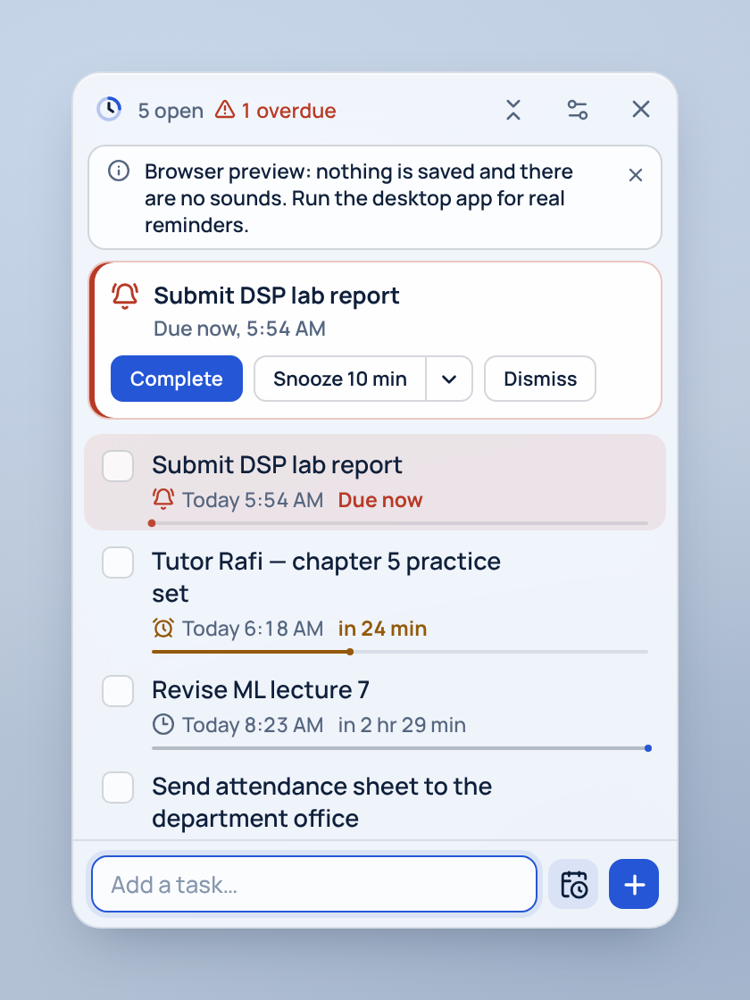

# Floating Todo

A small always-on-top task panel for Windows. It sits in a corner of the desktop, shows what is due next and how long remains, and plays a sound — once, with bounded repeats — when a task's time arrives. Tasks stay on your computer; there is no account and no network use.



> "Floating Todo" is a working name. Change `productName` (and `identifier` if you want a separate data folder) in `src-tauri/tauri.conf.json`; the UI reads the name from there.

## What it does
- **Quick add**: type a title and press Enter. Alt+Enter (or the calendar button) adds date, time, an early reminder and notes.
- **Time in every row**: "Today 17:30 · in 25 min", a thin *fuse* line that shortens during the last hour, and clear *Due now* / *Overdue* states (colour, icon and words).
- **Reminders that fire while hidden**: the scheduler runs in the native process, not the web page. A due task shows an alert banner, a Windows notification and a sound; Complete, Snooze or Dismiss from the banner.
- **No alert storms**: each reminder fires exactly once; repeats are limited (default 2 more rings, 5 minutes apart); after a restart, everything missed is combined into one alert.
- **Edit, complete, reopen, delete with undo**, all from the keyboard if you like.
- **Compact mode**, adjustable opacity, optional acrylic blur, launch at login, configurable global shortcut, system-tray icon.

## Install (Windows 10/11)

### From an installer
Build one (below) or download the `floating-todo-windows` artifact from the GitHub Actions run, check its hash against `SHA256SUMS.txt`, then run `Floating Todo_0.1.0_x64-setup.exe` (per-user, no admin needed) or the `.msi`. The installer downloads the WebView2 runtime if Windows 10 doesn't have it.

The installer is not code-signed, so SmartScreen will warn on first run ("More info → Run anyway"). Signing requires a certificate and is outside this project.

### Build it yourself
Requirements:
1. [Rust](https://rustup.rs) 1.95 or newer (`rustup default stable`)
2. Node.js 22 LTS or newer
3. Microsoft C++ Build Tools with the **Desktop development with C++** workload
4. WebView2 runtime (already on Windows 11)

```powershell
git clone <this repository> floating-todo
cd floating-todo
npm ci
npm run desktop:build
```
Installers appear in `src-tauri\target\release\bundle\nsis\` and `...\bundle\msi\`.

## Develop
```bash
npm ci
npm run desktop:dev        # the real desktop app with hot reload
npm run dev                # browser preview only (in-memory, no sounds; labelled in the UI)
```

### Checks
```bash
npm run check:all          # typecheck + lint + Vitest + cargo test
npm run test:e2e           # Playwright UI flows against the browser preview
cargo clippy --manifest-path src-tauri/Cargo.toml --all-targets -- -D warnings
scripts/smoke-linux.sh     # Linux/CI: launches the release binary, fires a real reminder, screenshots
```
If Playwright can't download its browser, point it at an installed Chrome: `PW_CHROMIUM_PATH=/path/to/chrome npm run test:e2e`.

On Linux you also need `libwebkit2gtk-4.1-dev libgtk-3-dev libayatana-appindicator3-dev librsvg2-dev libasound2-dev`.

## Using it
| Action | How |
|---|---|
| Show the widget from anywhere | `Ctrl+Alt+Space` (change in Settings), or click the tray icon |
| New task | `Ctrl+N` or `/`, type, `Enter` |
| Date, time, reminder, notes | `Alt+Enter` in the quick-add box |
| Move between tasks | `↑` / `↓` |
| Complete / reopen | `Space` |
| Edit | `Enter` or `E`; save with `Ctrl+Enter`; cancel with `Esc` |
| Delete / undo | `Delete`, then `Ctrl+Z` within 6 seconds |
| Snooze / dismiss the alert | `Alt+S` / `Alt+D` |
| Hide | × button (keeps running in the tray). Quit from the tray menu or Settings. |

Your data lives in `%APPDATA%\app.floatingtodo.desktop\floating-todo.db` (shown in Settings → About). Copy that file to back it up. Before a schema upgrade the app saves `floating-todo.db.bak-vN` next to it.

## Limitations (read these)
- **Reminders only ring while the app is running.** Closing the widget keeps it in the tray; *Quit* stops reminders. Turn on *Open when I sign in* so it is running after a restart. Anything missed while it was closed is shown once at the next launch.
- **Windows Focus Assist / Do Not Disturb** can hide the toast notification. The in-widget banner and sound still work.
- **Notification buttons** aren't used; act on alerts in the widget.
- **Acrylic blur** is off by default because it lags while dragging on Windows 10.
- **Deadlines are absolute moments.** If you travel to another timezone, a 17:30 Dhaka deadline shows as the equivalent local time.
- A time skipped by a daylight-saving change is rejected with a message; an ambiguous time resolves to the earlier occurrence.
- Verified on Linux in this build (tests, release build, desktop smoke run). The Windows installer is produced by the included workflow but was not executed in the environment this was built in; see `docs/IMPLEMENTATION_PLAN.md` §6 for exactly what has and hasn't been observed.

## Troubleshooting
| Problem | Fix |
|---|---|
| "Couldn't play the alert sound" | Check the default output device and volume; use Settings → Test. |
| "…couldn't be registered — another app may be using it" | Pick a different global shortcut in Settings. The old one keeps working. |
| "Can't open your task database" | Close other copies, check the file isn't read-only or synced mid-write, then Retry. The file is never deleted automatically. To start fresh, move it elsewhere. |
| Widget is off-screen after unplugging a monitor | It is moved back automatically on next launch; or use the global shortcut. |
| No toast notifications in `npm run desktop:dev` | Expected: toasts need the installed app's identity. Install the built `.exe`. |

## Security and privacy
Local only: no telemetry, no update checks, no network requests. The web view can call only the app's own commands plus window dragging/resizing (`src-tauri/capabilities/main.json`); no file system, shell or HTTP access is granted. All SQL uses bound parameters and every command validates its input in Rust. See `docs/TRD.md` §8.

### Release verification
Build from source on a clean runner (the GitHub workflow does this), publish the `SHA256SUMS.txt` it records, and compare hashes before installing. A clean antivirus scan is not proof of safety; building from reviewed source is the stronger guarantee.

## Project layout
```
docs/                 PRD, TRD, app flow, UI/UX spec, database schema, implementation plan
src/                  React + TypeScript UI
  domain/             pure time, sorting and validation logic (+ tests)
  components/         widget UI
  lib/                typed backend client, browser-preview backend, motion
  state/              app state provider, minute-aligned clock hook
  styles/app.css      design tokens and component styles
src-tauri/            Rust desktop app
  src/db/             SQLite connection, migrations, repository
  src/domain/         validation, reminder planning, clock
  src/scheduler.rs    reminder engine
  src/audio.rs        synthesized alert tones
  src/alerts.rs       sound + notification + events
  src/commands.rs     IPC boundary
  src/window.rs, tray.rs, shortcut.rs
  tests/              repository and scheduler integration tests
e2e/                  Playwright UI flows
scripts/              Linux desktop smoke test
```

## Licence
MIT. Third-party: Tauri (MIT/Apache-2.0), React (MIT), Tailwind CSS (MIT), lucide (ISC), Manrope (OFL-1.1), GSAP (GSAP Standard "no charge" licence), rusqlite (MIT), rodio (MIT/Apache-2.0).
