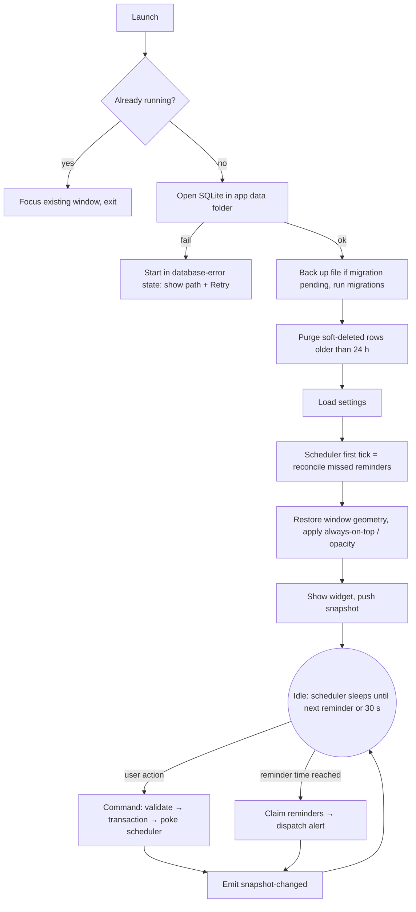
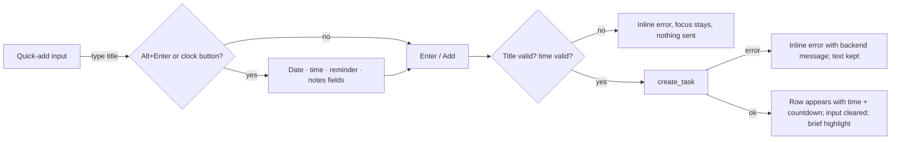
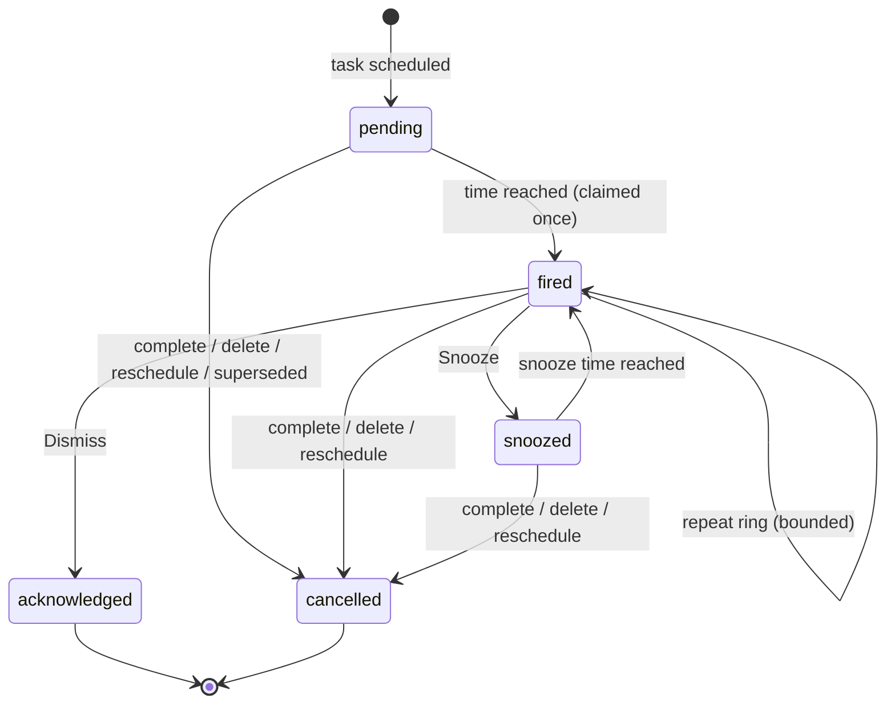

# Floating Todo — App Flow and Interaction Design

Requirements: [PRD](PRD.md). Mechanisms: [TRD](TRD.md) §5–7. States and statuses: [DATABASE_SCHEMA](DATABASE_SCHEMA.md) §4.

## 1. Primary flow



## 2. Task creation



- Date defaults to today when only a time is given; time defaults to 09:00 when only a date is given (shown in the field, not hidden).
- A deadline in the past is allowed (logging something already late) and is stored with its due reminder already acknowledged, so it shows *Overdue* without ringing.
- Lead reminder is only created if its firing time is still in the future.

## 3. Reminder and alert lifecycle



### Overdue alert

```mermaid
sequenceDiagram
  participant S as Scheduler (Rust)
  participant DB as SQLite
  participant A as Alerts
  participant W as Widget
  S->>DB: BEGIN; select reminders with next_fire_at ≤ now
  S->>DB: UPDATE … status='fired' WHERE status IN (pending, snoozed)
  S->>DB: verify task pending & not deleted; COMMIT
  S->>A: claimed reminders (0..n)
  A->>A: one notification + one sound for the batch
  A->>W: alert-fired, snapshot-changed
  W->>W: banner: Complete · Snooze · Dismiss; row → Overdue
  alt Complete
    W->>S: set_task_completed → reminders cancelled, audio stopped
  else Snooze n min
    W->>S: snooze_alert → snoozed_until = now + n; deadline unchanged
  else Dismiss
    W->>S: dismiss_alert → acknowledged; task stays overdue
  end
```

Snoozing shows "Snoozed until 17:45" on the row while the deadline label still reads the real time. Dismiss never deletes.

## 4. Additional flows

| Flow | Steps | Edge cases |
|---|---|---|
| **Edit** | Row → pencil / Enter / E → inline editor (title, date, time, reminder, notes) → Save (Ctrl+Enter, or Enter in the title) | If the date, time or reminder changes, reminders are replaced in the same transaction; an active alert clears and audio stops. A title/notes-only edit leaves reminders and any active alert as they are. Editing a completed task keeps it completed. |
| **Delete + undo** | Trash / Delete key → row leaves; toast "Deleted · Undo" for 6 s | Reminders cancelled in the same transaction. Undo recomputes reminders (past deadline → no ring). Several deletes in a row: the toast (and Ctrl+Z) offers the most recent one. |
| **Complete / reopen** | Checkbox / Space | Completing stops audio. Reopen with future deadline re-arms reminders; with past deadline shows Overdue silently. |
| **Tray restore** | Tray left-click, tray menu Show, or global shortcut | Global shortcut also focuses quick-add. If the shortcut cannot be registered (taken by another app), Settings shows the error and the previous binding remains. |
| **Size & opacity** | Drag edges/grip; Settings → opacity slider; header button toggles compact | Saved geometry is ignored if its monitor is gone. |
| **Sound** | Settings → sound on/off, tone, volume, repeat policy, Test | Test plays through the same path as alerts; failure shows the reason. |
| **Restart recovery** | Covered by first tick | Many overdue → one alert "4 tasks are overdue"; stale lead reminders cancelled silently. |
| **Notification failure** | `show()` returns error | `app-issue` banner once per session; banner + sound still work. On Windows, permission is not user-revocable per app via this API; Focus Assist suppression cannot be detected and is documented. |
| **Database error** | Open/migrate fails | Error screen with message, database path and Retry; the file is never deleted automatically. A write failure on any command shows an inline error and keeps the user's input. |
| **Scheduler error** | A tick fails | Logged, `app-issue` emitted, loop retries after 30 s; never panics the app. |
| **Sleep / clock change** | Wall clock re-read every ≤ 30 s | Reminders whose time passed during sleep are handled by the late rules. |

## 5. Focus management
- On show via shortcut: quick-add focused.
- After creating: quick-add stays focused for the next task.
- After deleting: focus moves to the next row (or previous, or quick-add).
- Editor opens with title focused; Esc returns focus to the row.
- Alert banner appearing does not steal focus from typing; `Alt+S`/`Alt+D` act on it.
