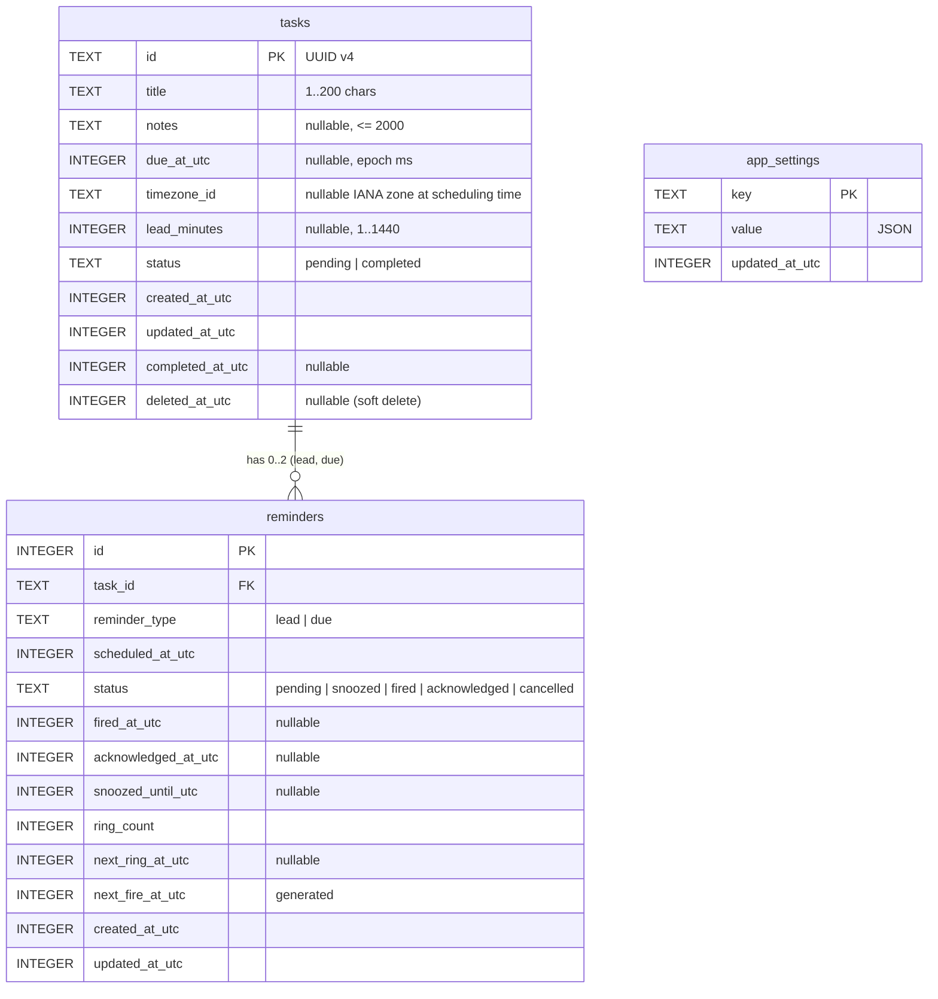

# Floating Todo — Database Schema and Data Design

Engine: SQLite (bundled with `rusqlite` 0.40). File: `<app data dir>/floating-todo.db` — on Windows `%APPDATA%\app.floatingtodo.desktop\floating-todo.db`.
Requirements: [PRD](PRD.md) FR-02 – FR-09. Scheduler semantics: [TRD](TRD.md) §6.

## 1. ER diagram



## 2. Table definitions (migration 1)

```sql
CREATE TABLE tasks (
  id               TEXT PRIMARY KEY NOT NULL CHECK (length(id) = 36),
  title            TEXT NOT NULL CHECK (length(trim(title)) BETWEEN 1 AND 200),
  notes            TEXT CHECK (notes IS NULL OR length(notes) <= 2000),
  due_at_utc       INTEGER,
  timezone_id      TEXT CHECK (timezone_id IS NULL OR length(timezone_id) <= 64),
  lead_minutes     INTEGER CHECK (lead_minutes IS NULL OR lead_minutes BETWEEN 1 AND 1440),
  status           TEXT NOT NULL DEFAULT 'pending' CHECK (status IN ('pending','completed')),
  created_at_utc   INTEGER NOT NULL,
  updated_at_utc   INTEGER NOT NULL,
  completed_at_utc INTEGER,
  deleted_at_utc   INTEGER,
  CHECK ((status = 'completed') = (completed_at_utc IS NOT NULL))
) STRICT;

CREATE INDEX idx_tasks_live ON tasks (status, due_at_utc) WHERE deleted_at_utc IS NULL;
CREATE INDEX idx_tasks_deleted ON tasks (deleted_at_utc) WHERE deleted_at_utc IS NOT NULL;

CREATE TABLE reminders (
  id                  INTEGER PRIMARY KEY AUTOINCREMENT,
  task_id             TEXT NOT NULL REFERENCES tasks(id) ON DELETE CASCADE,
  reminder_type       TEXT NOT NULL CHECK (reminder_type IN ('lead','due')),
  scheduled_at_utc    INTEGER NOT NULL,
  status              TEXT NOT NULL DEFAULT 'pending'
                      CHECK (status IN ('pending','snoozed','fired','acknowledged','cancelled')),
  fired_at_utc        INTEGER,
  acknowledged_at_utc INTEGER,
  snoozed_until_utc   INTEGER,
  ring_count          INTEGER NOT NULL DEFAULT 0 CHECK (ring_count >= 0),
  next_ring_at_utc    INTEGER,
  next_fire_at_utc    INTEGER GENERATED ALWAYS AS (
                        CASE status
                          WHEN 'pending' THEN scheduled_at_utc
                          WHEN 'snoozed' THEN snoozed_until_utc
                          WHEN 'fired'   THEN next_ring_at_utc
                        END) STORED,
  created_at_utc      INTEGER NOT NULL,
  updated_at_utc      INTEGER NOT NULL,
  UNIQUE (task_id, reminder_type),
  CHECK (status <> 'snoozed' OR snoozed_until_utc IS NOT NULL)
) STRICT;

CREATE INDEX idx_reminders_next_fire ON reminders (next_fire_at_utc) WHERE next_fire_at_utc IS NOT NULL;
CREATE INDEX idx_reminders_task ON reminders (task_id);

CREATE TABLE app_settings (
  key            TEXT PRIMARY KEY NOT NULL,
  value          TEXT NOT NULL CHECK (json_valid(value)),
  updated_at_utc INTEGER NOT NULL
) STRICT;
```

Connection pragmas: `journal_mode=WAL`, `foreign_keys=ON`, `synchronous=NORMAL`, `busy_timeout=3000`.

### Why these choices
- **Epoch milliseconds (INTEGER)** for every instant: unambiguous, sortable, no string-parsing of local time. Display formatting happens in the UI with the current local timezone.
- **`timezone_id`** records where the user was when scheduling (diagnostics and potential future "floating" deadlines); it is never used to reinterpret `due_at_utc`.
- **`UNIQUE (task_id, reminder_type)`** makes a duplicate reminder for the same purpose structurally impossible.
- **`next_fire_at_utc` generated column + partial index** gives the scheduler one indexed query for "what's next" regardless of state.
- **Soft delete** enables undo; purge after 24 h.
- **`STRICT` tables** reject wrong types (SQLite ≥ 3.37; the bundled build is newer).

## 3. `app_settings` keys

| Key | Type (JSON) | Default | Range / values |
|---|---|---|---|
| `sound_enabled` | bool | `true` | |
| `sound_name` | string | `"chime"` | `chime`, `bell`, `soft` |
| `sound_volume` | number | `0.7` | 0.0–1.0 |
| `repeat_count` | int | `2` | 0–3 extra rings |
| `repeat_interval_min` | int | `5` | 2–30 |
| `default_snooze_min` | int | `10` | 1–240 |
| `default_lead_min` | int or null | `null` | null or 1–1440 |
| `always_on_top` | bool | `true` | |
| `launch_at_login` | bool | `false` | mirrored to the OS via autostart |
| `opacity` | number | `0.94` | 0.85–1.0 |
| `acrylic` | bool | `false` | |
| `compact` | bool | `false` | |
| `show_completed` | bool | `false` | |
| `bring_forward_on_alert` | bool | `true` | |
| `global_shortcut` | string | `"Ctrl+Alt+Space"` | parsed by global-shortcut plugin |
| `window_geometry` | object | none | `{x,y,width,height,expandedHeight}` physical px |

Unknown keys are ignored; invalid stored values fall back to defaults with a logged warning (so a hand-edited file cannot crash startup). The schema version lives in SQLite's `PRAGMA user_version`, managed by `rusqlite_migration`.

## 4. Time and reminder semantics

| Term | Meaning | Stored as |
|---|---|---|
| **Deadline** | When the task is due | `tasks.due_at_utc` |
| **Lead time** | How long before the deadline to warn | `tasks.lead_minutes` |
| **Reminder firing time** | When a reminder is planned to fire | `reminders.scheduled_at_utc` (= deadline, or deadline − lead) |
| **Snoozed alert time** | When a snoozed alert rings again | `reminders.snoozed_until_utc` — deadline is untouched |
| **Acknowledgement** | User dismissed the alert | `reminders.status='acknowledged'`, `acknowledged_at_utc` |
| **Completion** | Task done | `tasks.status='completed'`, `completed_at_utc`; reminders cancelled |

Reminder planning (pure function `plan_reminders(task, now)`):
- No deadline or task completed/deleted → no reminders.
- `due` reminder at the deadline. If the deadline is already past when saved → inserted as `acknowledged` (shows overdue, never rings).
- `lead` reminder at deadline − lead, only if that is in the future.

Active alert = reminder with `status='fired'` on a live pending task. Snoozed reminders are shown on the row but are not active alerts until they fire again.

## 5. Interaction with completion and deletion

| Task event | Reminders effect (same transaction) |
|---|---|
| Complete | All `pending`/`snoozed`/`fired` → `cancelled`; audio stopped |
| Reopen | Old reminders deleted; re-planned from now |
| Edit time/lead | Old reminders deleted; re-planned (completed task: just deleted) |
| Edit title/notes only | Reminders untouched |
| Soft delete | All non-terminal → `cancelled` |
| Restore | Old reminders deleted; re-planned |
| Purge (hard delete) | `ON DELETE CASCADE` removes rows |

Invariant (tested): no row with `next_fire_at_utc IS NOT NULL` exists for a task that is completed or soft-deleted. The scheduler also re-checks task state when claiming.

## 6. Repository layer
`src-tauri/src/db/repo.rs` exposes typed functions taking `&Connection` (a `Transaction` derefs to one): `list_tasks`, `get_task`, `create_task`, `update_task`, `set_completed`, `soft_delete`, `restore`, `purge_deleted_before`, `active_alerts`, `due_reminders`, `claim_fire`, `claim_repeat`, `stop_repeats`, `cancel_reminder`, `next_fire_at`, `snooze`, `acknowledge`, `load_settings_map`, `save_settings`. The snoozed-until time shown on a row is a sub-select in the task query. All SQL is parameterised (`params![]`); no string concatenation of values.

## 7. Validation (backend, authoritative)
| Field | Rule |
|---|---|
| id | UUID format |
| title | trimmed, 1–200 Unicode scalar values, control characters rejected (except none) |
| notes | ≤ 2000 chars, trimmed; empty → NULL |
| due_at_utc | 946684800000 (2000-01-01) ≤ x ≤ 4102444800000 (2100-01-01) |
| lead_minutes | 1–1440 or null; ignored if no deadline |
| timezone_id | ≤ 64 chars, `[A-Za-z0-9_+\-/]` |
| snooze minutes | 1–240 |
| settings | per §3 ranges |

The frontend repeats the same rules for immediate feedback (`src/domain/validate.ts`).

## 8. Transactions
One transaction per command (`BEGIN IMMEDIATE`). The scheduler tick is one transaction. Both run under one `Mutex<Connection>`, so they serialise.

## 9. Migrations, recovery, backup
- Migrations are an ordered list in `db/migrations.rs`; each is append-only once released.
- Before applying any pending migration to an existing database, the file is copied to `floating-todo.db.bak-v<from>` (`VACUUM INTO`).
- Open or migration failure → app starts in the database-error screen showing the path; the file is never deleted or overwritten automatically. Retry re-attempts open.
- Backup: the user can copy the `.db` file while the app is closed (or anytime; WAL is checkpointed on exit).
- Tested: fresh create, reopen with data, migration idempotence, invalid stored setting fallback.
