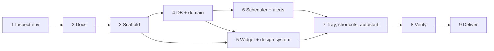

# Floating Todo — Implementation Plan

Drives delivery of [PRD](PRD.md) using [TRD](TRD.md), [APP_FLOW](APP_FLOW.md), [UI_UX_SPEC](UI_UX_SPEC.md) and [DATABASE_SCHEMA](DATABASE_SCHEMA.md).

## 1. Environment (Phase 1 findings)
| Item | Finding |
|---|---|
| Workspace | Empty; new repository `floating-todo/` |
| Build host | Linux x86_64 cloud VM (no Windows host available) |
| Toolchain | Rust 1.97.0, Node 22.22, npm 10.9; WebKitGTK 4.1 installed for Linux Tauri builds |
| Tauri | 2.12.2 stable selected; 3.0 is alpha |
| Consequence | The app is compiled, tested and launched on Linux. The Windows installer is produced by the included GitHub Actions workflow (`.github/workflows/windows-build.yml`) or locally on Windows with `npm run desktop:build`. Windows-specific behaviour (toasts, acrylic, autostart registry) is implemented against the documented APIs but **not executed in this environment**. |

## 2. Dependency graph

## 3. Phases

| Phase | Output | Exit check |
|---|---|---|
| 1 Inspect | §1 | Toolchain versions recorded |
| 2 Docs | six documents | Cross-references consistent |
| 3 Scaffold | Vite/React/TS/Tailwind, Tauri crate, capabilities, ESLint, Vitest, Playwright | `npm run typecheck`, `cargo check` pass |
| 4 DB + domain | migrations, repo, validation, reminder planning, clock | `cargo test` (db, domain) pass |
| 5 Widget | tokens, components, keyboard map, browser-preview backend | `npm test` pass, screenshots reviewed |
| 6 Scheduler + alerts | tick, runtime thread, audio, notifications, snooze/dismiss | scheduler tests with fake clock pass |
| 7 System | tray, global shortcut, autostart, single instance, geometry | Debug build launches |
| 8 Verify | all checks, release build, measurements | §6/§7 filled from real runs |
| 9 Deliver | README, workflow, report | — |

## 4. Risks
| Risk | Mitigation |
|---|---|
| No Windows host to execute the build | CI workflow on `windows-latest`; all logic platform-neutral and tested on Linux; Windows-only calls isolated and error-reported |
| Duplicate alerts (two instances, races) | single-instance plugin; atomic claim; shared connection mutex; tests |
| Sleep/clock change | ≤ 30 s wall-clock re-check; late rules |
| Audio device missing | error surfaced; visual alert independent |
| Acrylic lag on Windows 10 | off by default |
| Global shortcut taken | registration error shown, old binding kept |
| Corrupt database | error screen, no auto-delete, pre-migration backups |

## 5. Test plan
| Level | Tool | Location |
|---|---|---|
| Unit (Rust) | `cargo test` | `src-tauri/src/**` `#[cfg(test)]` |
| Integration (Rust, real SQLite file) | `cargo test` | `src-tauri/tests/` |
| Unit/component (TS) | Vitest + Testing Library | `src/**/*.test.ts(x)` |
| End-to-end UI (browser-preview backend) | Playwright | `e2e/` |
| Desktop smoke | debug/release binary under Xvfb + screenshot | manual script `scripts/smoke-linux.sh` |

Time-dependent tests use an injected clock (`FakeClock` in Rust, explicit `now` in TS); none wait on real time.

## 6. Requirements checklist

Status as of 2026-10-10, from runs in the Linux build environment. **Verified** = exercised by an automated test or the desktop smoke run. **Implemented, not run** = written against documented APIs but needs a Windows machine to observe.

| Req | Implementation | Evidence | Status |
|---|---|---|---|
| FR-01 floating widget | `tauri.conf.json`, `window.rs`, `tray.rs`, `Header.tsx` | Release binary launched under X11, frameless panel placed bottom-right (smoke screenshot); geometry visibility tests (`window.rs`) | Verified on Linux. Always-on-top, tray click and acrylic: implemented, not run on Windows |
| FR-02 creation | `QuickAdd.tsx`, `validate.ts/.rs`, `repo::create_task` | `validate.test.ts`, `validate.rs` tests, `Widget.test.tsx`, e2e "create…" | Verified |
| FR-03 time & countdown | `domain/time.ts`, `useNow.ts`, `TaskRow.tsx` | `time.test.ts` (incl. DST in Europe/London), `useNow.test.ts`, e2e | Verified |
| FR-04 reminders | `scheduler.rs`, `alerts.rs`, `repo.rs` | 18 scheduler tests (fake clock), smoke run: reminder inserted in the real DB fired once (`status=fired, ring_count=1`) | Verified (native toast display on Windows: implemented, not run) |
| FR-05 audible alerts | `audio.rs`, `alerts.rs`, Settings | Tone synthesis tests; failure path verified in smoke run (no sound card → banner with reason) | Audio *playback* not heard in this environment (no output device) — needs a check on Windows |
| FR-06 editing | `TaskEditor.tsx`, `repo::update_task` | repository + scheduler "rescheduling" tests, e2e | Verified |
| FR-07 deletion + undo | `repo::soft_delete/restore`, `UndoToast.tsx` | repository tests, `Widget.test.tsx`, e2e (mouse and keyboard) | Verified |
| FR-08 completion | `repo::set_completed`, `TaskRow.tsx` | repository/scheduler tests, e2e | Verified |
| FR-09 persistence | `db/*` | reopen-file test, smoke run against a real file | Verified |
| FR-10 keyboard | `Widget.tsx`, `TaskRow.tsx`, `shortcut.rs` | `Widget.test.tsx`, e2e keyboard-only flow, accelerator parse test | Verified in-window; global shortcut registration: implemented, not run on Windows |
| FR-11 empty/error states | `EmptyState`, `DatabaseErrorScreen`, `IssueBanner` | `Widget.test.tsx`; corrupt/newer-schema DB tests | Verified |
| Launch at login | `tauri-plugin-autostart` | — | Implemented, not run |
| Single instance | `tauri-plugin-single-instance` | — | Implemented, not run |

### Test totals (last run)
| Suite | Command | Result |
|---|---|---|
| TypeScript unit + component | `npm test` | 52 passed (5 files) |
| Rust unit | `cargo test --lib` | 23 passed |
| Rust integration | `cargo test --test repository --test scheduler` | 16 + 18 passed |
| End-to-end UI | `PW_CHROMIUM_PATH=… npm run test:e2e` | 6 passed |
| Type check / lint | `npm run typecheck`, `npm run lint`, `cargo clippy -D warnings` | clean |
| Desktop smoke | `scripts/smoke-linux.sh` | launched, reminder fired once, widget showed overdue alert |
| Windows installer | `.github/workflows/windows-build.yml` | **not run** (no Windows runner available here) |

## 7. Measurements
Linux x86_64, Xvfb with software rendering (`LIBGL_ALWAYS_SOFTWARE=1`), release build, `scripts/smoke-linux.sh`:

| Metric | Value | Note |
|---|---|---|
| Release binary | 6.3 MB | `src-tauri/target/release/floating-todo` |
| `.deb` bundle | 2.95 MB | |
| Frontend JS | 341 kB (112 kB gzip) | React + GSAP + icons |
| Idle CPU, 20 s window | 0.15 % | app + 2 WebKit helper processes |
| Resident memory | ≈ 339 MB total | software-rendered WebKitGTK; WebView2 on Windows will differ and should be measured there |

Not measured: startup time and Windows figures.
