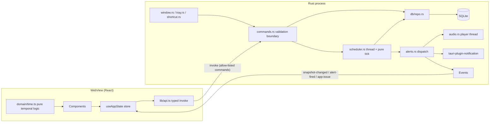

# Floating Todo — Technical Requirements Document (TRD)

Implements the requirements in [PRD.md](PRD.md). Data model in [DATABASE_SCHEMA.md](DATABASE_SCHEMA.md); flows in [APP_FLOW.md](APP_FLOW.md).

## 1. Stack (pinned)

| Layer | Choice | Version | Why |
|---|---|---|---|
| Desktop runtime | Tauri | 2.12.2 (crate), CLI 2.12.1 | Native window, tray, small binaries, capability-based IPC. Tauri 3 is alpha — not used. |
| Language (native) | Rust | 1.95+ (dependency minimum; built with 1.97) | Scheduler, persistence, audio run outside the web view |
| Frontend | React + TypeScript | 19.3.0 / 6.0.3 | Typed UI; TS 6 because typescript-eslint supports `<6.1` |
| Build | Vite | 8.3.4 | |
| Styling | Tailwind CSS (+ `@tailwindcss/vite`) | 4.3.3 | Tokens defined as CSS variables in `@theme` |
| Icons | lucide-react | 1.54.0 (ISC) | One consistent outline set |
| Font | Manrope via `@fontsource-variable/manrope` | 5.3.0 (OFL-1.1) | Bundled locally, no font CDN |
| Animation | CSS transitions; GSAP | 3.15.0 (GSAP Standard "no charge" licence) | GSAP only for list enter/exit and the overdue transition |
| Database | SQLite via `rusqlite` (bundled) | 0.40 | Single-file, transactional, no server |
| Migrations | `rusqlite_migration` | 2.6 | Ordered, `user_version`-based |
| Audio | `rodio` (playback only, no decoders) | 0.22 | Tones are synthesized in code — no audio assets to license |
| Plugins | notification 2.5.1, global-shortcut 2.4.0, autostart 2.7.0, single-instance 2.5.2 | | All used from Rust only; no JS plugin packages shipped |
| Tests | Vitest 5 + Testing Library + jsdom; `cargo test`; Playwright 1.64 | | |

Lockfiles (`package-lock.json`, `src-tauri/Cargo.lock`) are committed.

## 2. Architecture



| Concern | Module | Notes |
|---|---|---|
| Presentation | `src/components/*`, `src/App.tsx`, tokens in `src/styles/app.css` | No business rules beyond formatting |
| Temporal display logic | `src/domain/time.ts` | Pure; injected `now` |
| IPC client | `src/lib/api.ts`, `src/lib/backend.ts` | Typed; a clearly-labelled browser-preview backend is used only when not running inside Tauri |
| Validation | `src-tauri/src/domain/validate.rs` (authoritative), `src/domain/validate.ts` (UX) | Same limits in both |
| Domain | `src-tauri/src/domain/{task,reminder,clock}.rs` | Reminder planning is pure |
| Persistence | `src-tauri/src/db/{mod,migrations,repo}.rs` | Only module that issues SQL |
| Scheduling | `src-tauri/src/scheduler.rs` | Pure `tick()` + thread runtime |
| Alerts | `src-tauri/src/alerts.rs`, `audio.rs` | Combines simultaneous alerts |
| Desktop | `src-tauri/src/{window,tray,shortcut}.rs` | Geometry persistence, tray, global shortcut |
| Settings | `src-tauri/src/settings.rs` | Typed struct, key/value storage |
| Shared state, events | `src-tauri/src/state.rs`, `src/state/AppContext.tsx` | Snapshot pushed after every change |

The frontend never touches the database. It holds a read-only snapshot pushed by the backend after every mutation (`snapshot-changed`), so it does not re-query on render.

## 3. Reference review
- **threeui.com** — reviewed for direction only; no 3D is used (a corner widget gains nothing from WebGL and would cost GPU and battery).
- **gsap.com** — GSAP 3.15 used narrowly (see UI/UX spec §7). Respects `prefers-reduced-motion`.
- **twentyones.dev**, **testskill.dev** — not retrievable by the build tooling (robots.txt disallows automated fetching). No components or rules were copied; the anti-slop intent is applied through explicit rules: no placeholder actions, every state designed, measured claims only, tests for every critical path.

## 4. IPC contract

All commands return `Result<T, AppError>`; errors serialise as `{ code, message }` with codes `validation`, `not_found`, `database`, `audio`, `notification`, `window`, `shortcut`, `internal`.

| Command | Input | Output | FR |
|---|---|---|---|
| `get_snapshot` | — | `Snapshot` | FR-09 |
| `create_task` | `TaskInput` | `Task` | FR-02 |
| `update_task` | `id`, `TaskInput` | `Task` | FR-06 |
| `set_task_completed` | `id`, `completed` | `Task` | FR-08 |
| `delete_task` | `id` | — | FR-07 |
| `restore_task` | `id` | `Task` | FR-07 |
| `snooze_alert` | `reminderId`, `minutes` | snoozed-until (epoch ms) | FR-04 |
| `dismiss_alert` | `reminderId` | — | FR-04 |
| `update_settings` | `SettingsPatch` | `Settings` | FR-01, FR-05 |
| `test_sound` | `sound?`, `volume?` | — (error if no output device) | FR-05 |
| `set_compact` | `compact`, `height?` (logical px) | — | FR-01 |
| `hide_widget` | — | — | FR-01 |
| `quit_app` | — | — | FR-01 |
| `retry_startup` | — | `Snapshot` | FR-11 |

`TaskInput = { title, notes?, dueAtUtc?: epoch ms, timezoneId?, leadMinutes? }`.
`Snapshot = { productName, tasks[], alerts[], settings, issues[], dbPath, version }`.

Events (backend → frontend): `snapshot-changed` (Snapshot), `alert-fired` (`{ alerts, playedSound }`), `app-issue` (`{ code, message }`), `focus-quick-add`.

## 5. Desktop window

`tauri.conf.json` window `main`: `decorations: false`, `transparent: true`, `alwaysOnTop: true`, `skipTaskbar: true`, `resizable: true`, `shadow: false` (on Windows an undecorated window with a native shadow gets a 1-px white border that clashes with the rounded panel), min 280×96, max 560×900, `visible: false` (shown after geometry restore to avoid a jump).

- Drag: `data-tauri-drag-region` on the header background only (buttons are not drag regions).
- Resize: OS edges on Windows (Tauri 2 supports undecorated resizing) plus a corner grip using `startResizeDragging`.
- Geometry: `Moved`/`Resized` events update an in-memory copy; written to SQLite at most every 500 ms, and always on hide and exit. On launch, restored only if the saved rectangle intersects a connected monitor.
- Compact mode: the UI measures the header + alert + most urgent task and passes that height to `set_compact`; Rust remembers the expanded height and restores it.
- Always on top / opacity / acrylic: settings applied live. Opacity is the CSS surface alpha (text stays opaque). Optional **Acrylic** (`set_effects(Acrylic)`) is off by default because acrylic on Windows 10 lags during drag; when unsupported the call's error is reported and the CSS surface is used.
- Close button → hide to tray. Tray: left-click toggles; menu = Show, New task, Always on top ✓, Quit.
- Single instance: a second launch focuses the existing window (prevents two schedulers double-firing).
- Launch at login: `tauri-plugin-autostart` (registry Run key on Windows), off by default.

## 6. Scheduling engine

Database is the source of truth. The runtime keeps no reminder list in memory.

```text
loop:
  now = clock.now()
  outcome = tick(db, now, settings)          # one transaction
  dispatch(outcome)                          # notification + sound + events, outside the lock
  wake = next_fire_at(db) (min of next_fire_at_utc over the partial index)
  wait on condvar until min(wake, now + 30 s) or until poked
```

- **Poke**: every mutation that can change reminders signals the condvar.
- **30-second cap**: wall-clock is re-read at least every 30 s, so sleep/resume and manual clock changes are observed within 30 s without relying on a monotonic timer that pauses during sleep.
- **Exactly-once**: a reminder is claimed with `UPDATE … SET status='fired' WHERE id=? AND status IN ('pending','snoozed')` inside the tick transaction, and only rows actually updated are dispatched. Mutations and ticks share one `Mutex<Connection>`, so an edit and a firing cannot interleave.
- **Late handling** (`LATE_THRESHOLD = 10 min`): late `lead` reminders whose deadline has also passed are cancelled (superseded); late `due` reminders fire with no repeats. All reminders claimed in one tick are combined into one notification and one sound.
- **Repeats**: on-time due reminders get `next_ring_at_utc = fired_at + interval` while `ring_count < 1 + repeats`. Acknowledge, snooze, complete, edit and delete clear it.
- **Startup reconcile**: the first tick runs before the window is shown; the same rules produce at most one combined alert.
- **Time**: all instants are UTC epoch milliseconds (`i64`). The frontend converts the user's local date/time selection with the platform's local-time rules and checks the round-trip, rejecting non-existent DST times with a message. The IANA zone at creation is stored for reference.

## 7. Audio
A dedicated thread owns the output device. Each play opens the default device (so a newly plugged headset is used), appends a synthesized tone (`Chime`, `Bell`, `Soft`), and keeps the device open until done. `Stop` clears the player immediately (used on complete/dismiss/snooze). Failures (no device) are returned to the caller, emitted as `app-issue`, and shown as a banner; the visual alert still appears.

## 8. Security
- **Capabilities**: `src-tauri/capabilities/main.json` grants only `core:event:allow-listen`, `core:event:allow-unlisten`, `core:window:allow-start-dragging`, `core:window:allow-start-resize-dragging`, and the app's own commands (generated by an app manifest in `build.rs`, so commands not listed are denied). No fs, shell, http, opener or plugin JS permissions.
- **CSP**: `default-src 'self'; style-src 'self' 'unsafe-inline'; img-src 'self' data:; font-src 'self' data:; connect-src ipc: http://ipc.localhost`, plus `freezePrototype`. No remote resources at runtime (the font is bundled).
- **SQL**: parameterised queries only; CHECK constraints mirror validation.
- **Input**: every command validates (length, ranges, enums, timestamp bounds 2000–2100, UUID format).
- **No updater**, no telemetry, no network calls.
- Dependencies are from crates.io and npm with lockfiles; licences: MIT/Apache-2.0/ISC/OFL plus GSAP's no-charge licence.
- No claim of being "malware-free": releases should be built from source on a clean runner and hashes published (README §Release verification).

## 9. Performance targets and measurement
- No polling except the scheduler's ≤ 30 s wall-clock check and the UI's minute-aligned refresh.
- All listeners and timers cleaned up in effect teardown (tested in `useNow.test.ts` and `Widget.test.tsx`).
- Commands are `async` so database work runs on Tauri's worker pool, never on the window's event loop.
- Database work happens on the Rust side, never on the UI thread; indexes cover the scheduler query.
- Measured figures are recorded in `IMPLEMENTATION_PLAN.md` §7 from actual runs, including platform.

## 10. Platform notes and limitations
- Reminders cannot fire while the app is not running. Launch-at-login mitigates; startup reconcile reports what was missed.
- Windows toast notifications require the installed app (AppUserModelID registered by the installer); in `tauri dev` they may show under PowerShell's identity.
- Windows Focus Assist / Do Not Disturb can suppress toasts silently; the in-widget banner and sound are unaffected.
- Notification action buttons are not used (not supported by the desktop notification plugin); actions live in the widget.
- Acrylic is optional due to Windows 10 drag lag.
